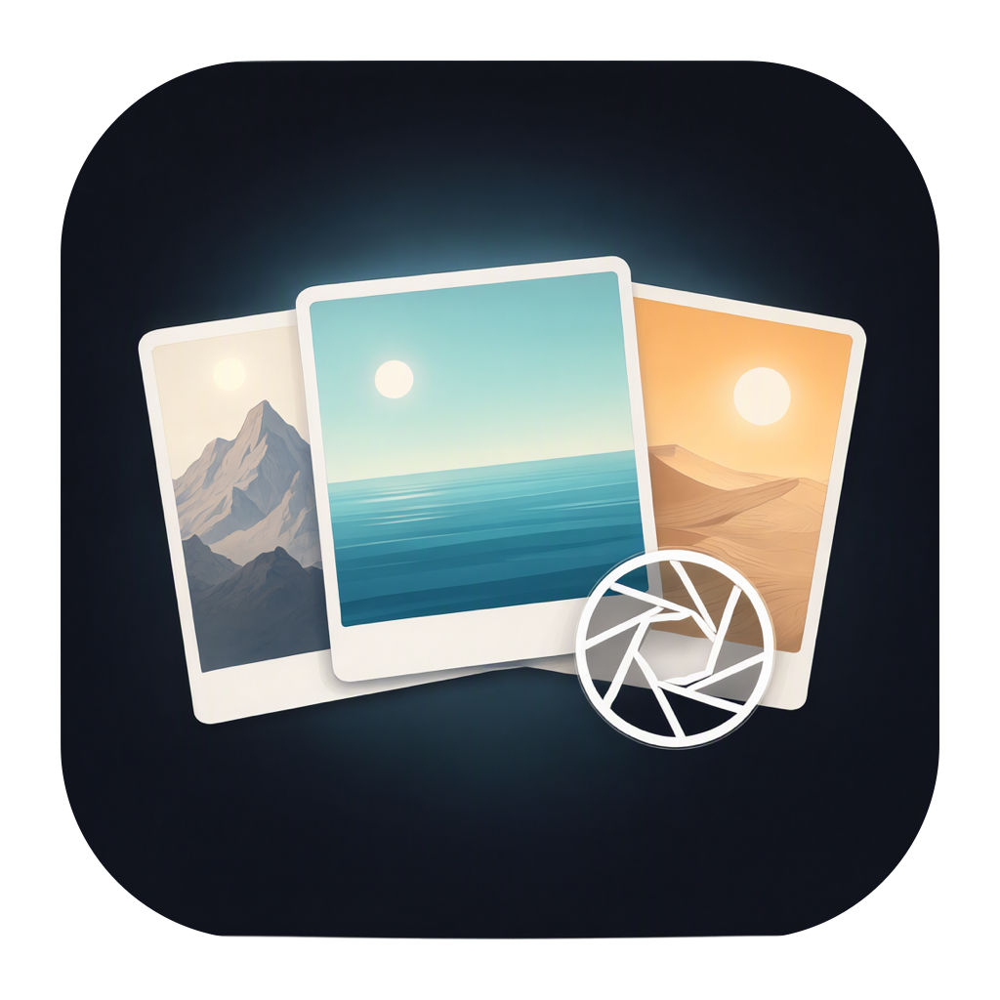

# Gallery

A local-only photo and video browser for macOS. Gallery reads folders **in place** — nothing is imported,
moved or uploaded — and builds albums, a viewer, search and editing tools on top of the files you already
have.



## What it does

- **Folders as libraries.** Pick a folder; Gallery enumerates it, reads metadata and bakes thumbnails.
  Live Photos, RAW, HEIC, JPEG, PNG, TIFF, GIF, WebP, AVIF and the common video containers are recognised.
- **Albums.** Folders and subfolders, days, months, places, types, favourites, duplicates, tags, People,
  and Smart categories (Screenshots, Documents & receipts, Icons & graphics, Wallpapers & memes).
- **Viewer.** Zoom, pan, slideshow, video transport, and true full screen (←/→ change photo, Esc exits).
- **Edit.** Crop, rotate, resize, convert, text and watermarks, collages, and metadata editing written into
  the file. Replace Original keeps a previous version that can be reverted for 30 days.
- **Bulk work.** Marquee, ⌘-click, ⇧-click, ⌘A, invert; delete, rename (find & replace, numbering, capture
  date), move, batch metadata, copy names/paths, Reveal, and Select Similar.
- **On-device analysis.** Vision supplies scene labels, OCR, face clusters, aesthetic scores and
  perceptual hashes. No image ever leaves the Mac.

## Install

1. Download `Gallery-<version>.zip` from the [latest release](../../releases/latest).
2. Unzip and drag **Gallery.app** into `/Applications`.
3. The app is signed locally, not notarised. The first launch needs **right-click → Open** (or
   System Settings → Privacy & Security → Open Anyway). If the zip was downloaded by a browser that
   quarantines it, `xattr -dr com.apple.quarantine /Applications/Gallery.app` clears the flag.
4. Add folders with **⌘O** or by dragging them onto the window. Finder also offers
   **Services ▸ Open Folder in Gallery** and **Open With ▸ Gallery** for folders.

After installing a new version, macOS may ask for folder access again: the sandbox ties a folder grant to
the app's signature. Re-add the folder (or open it from Finder) and the library comes back.

## Privacy

- Sandboxed with three entitlements: app sandbox, user-selected read/write files, and outgoing network
  for reverse geocoding.
- Only folders you explicitly choose are readable. There is no photo-library access, no background
  upload, no analytics and no account.
- Reverse geocoding uses Apple's service when a place name can be resolved; without a network, albums keep
  coordinate names and everything else works.

## Build and test

Requires macOS 15+, Xcode 16 (Swift 6) and the Xcode command-line tools.

```sh
# Unit tests (Swift Testing)
DEVELOPER_DIR=/Applications/Xcode.app/Contents/Developer swift test

# Assemble and sign build/Gallery.app (release configuration)
DEVELOPER_DIR=/Applications/Xcode.app/Contents/Developer Scripts/bundle-app.sh release
```

The bundle script prefers a local **Apple Development** identity and falls back to an ad-hoc signature.
There is no notarisation step and no paid developer account is required.

## Limits worth knowing

- Search returns the first 500 matches; the toolbar says so when the cap is reached.
- One confirmed batch action processes at most 20,000 rows and reports when it truncates.
- A collage holds at most 12 photos; Trash and previous versions are kept for 30 days.
- Sidecar files (`.AAE`, `.XMP`) follow a rename or move, but they are not catalog rows and are not shown
  in the grid.
- Categories are explainable heuristics over stored signals. The **Analysis ▸ Export Category Audit…** CSV
  exists so precision can be measured by hand on a real library; no precision number is claimed until
  that audit is run.
- The app is arm64-only and not notarised.

## Licence

Private project. All rights reserved.
